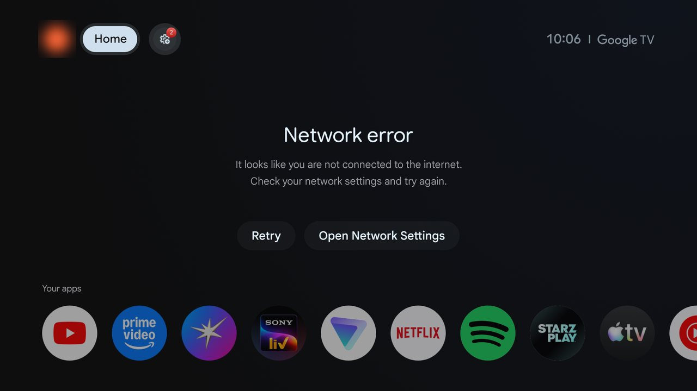
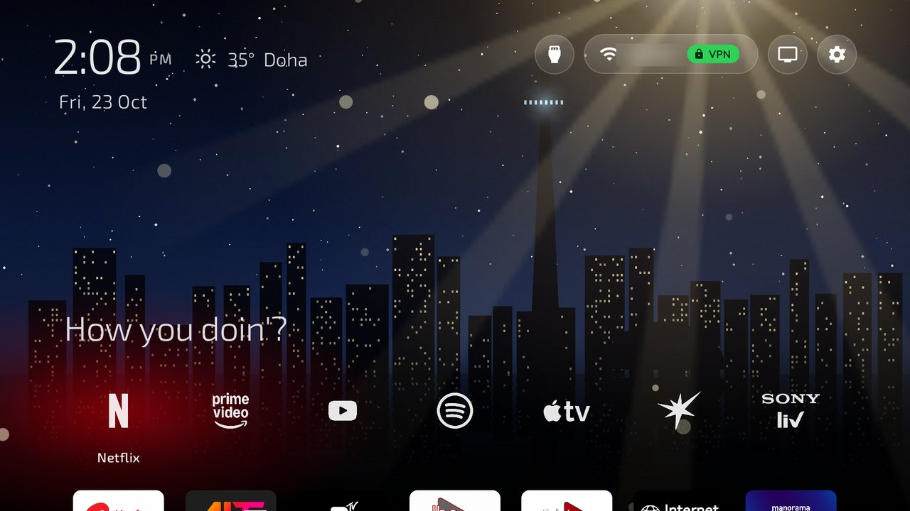
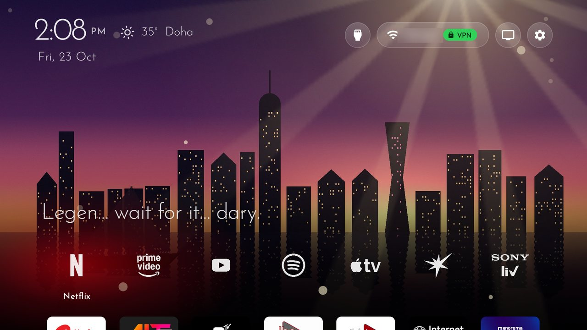
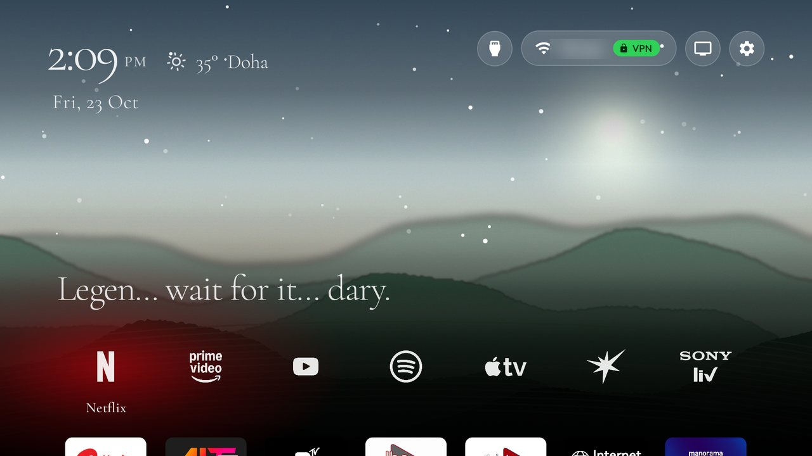
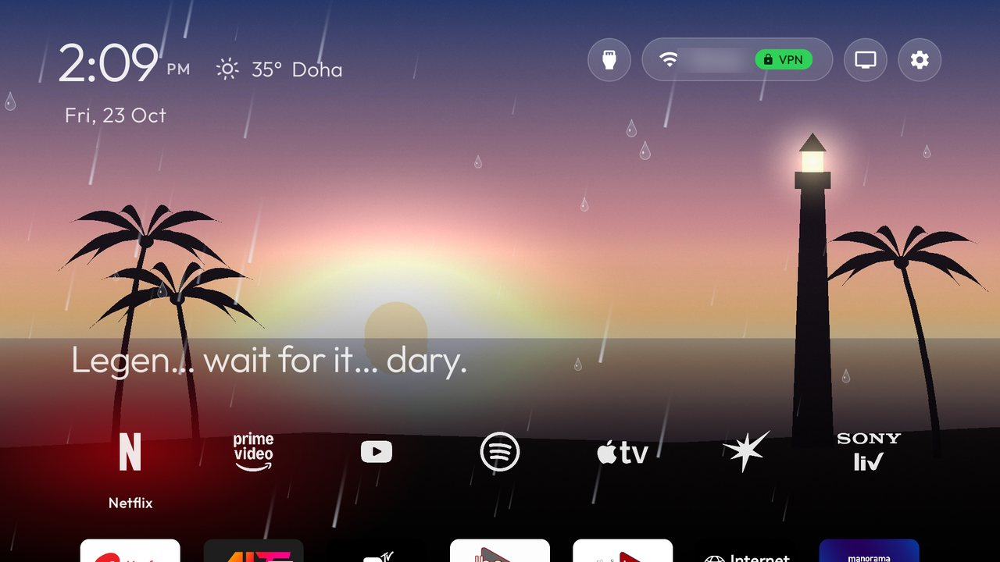
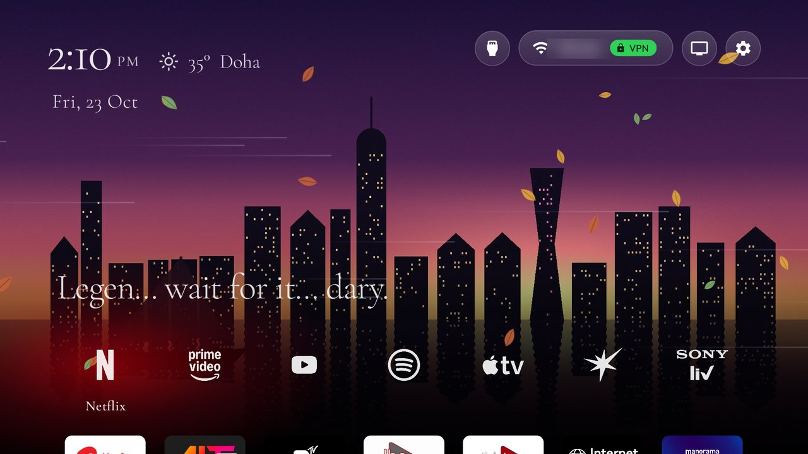
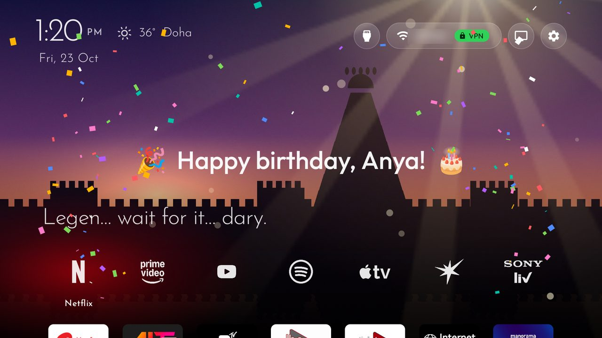

# Family Home for Android TV

A calm, fun home screen for a family Android TV: white app logos floating on your own photos, the weather of the
places your family lives in (with rain, snow, storms and wind right on the screen), a new picture and font every
time you come back to Home, and confetti on everyone's birthday. Made for a Sony BRAVIA VU3 (Google TV 14) that
the kids use every day, and built on top of [Clean Your TV](https://github.com/Gathin23/cleanyourtv).

| Before: the stock Google TV home | After: Family Home |
|---|---|
|  |  |

## What it does

- **A white logo dock**: no tiles, no ads, no recommendation rows. The focused logo grows, its name fades in, and a
  soft glow in the app's colour follows you around.
- **Taglines**: a line from a favourite show above the dock ("To infinity and beyond!", "Friends don't lie."),
  a different one each time you come back.
- **Weather for the whole family**: the clock, the date, and the weather of a few places taking turns, each with
  its local time.
- **Weather on screen**: sun rays, twinkling and shooting stars, rain sliding down the glass, storms with lightning,
  spinning snowflakes and blowing leaves, matching the place on display.
- **Wallpaper sets**: your own photos, plus drawn scenes (places, aurora, autumn, glass), one button away.
- **A new font on every visit**, without anything on the screen moving.
- **Birthdays**: "Happy birthday!" and confetti on the day, kept out of the repository.
- **Wi-Fi and VPN at a glance** in the top bar.

| Sunny | Clear night | Rain |
|---|---|---|
|  |  |  |
| **Storm** | **Snow** | **Wind** |
|  |  |  |

## Use it on your TV

Everything is in **[family-home/](../family-home/README.md)**: what each part does, how to set it up, and how to
change the taglines, places, photos, logos and birthdays. Your own photos, logos and birthdays go in a private
folder that never leaves your computer.

It needs an Android TV or Google TV set the original project supports and a computer on the same network. The whole
TV clean-up (removing the bloat, installing the launcher) follows the original project's
[PROMPT.md](../PROMPT.md).

## Credits

- **[Clean Your TV](https://github.com/Gathin23/cleanyourtv)** by Gathin23 and its contributors (MIT): the launcher,
  the tools and the TV clean-up this is built on. Its own README is [here](../README.md).
- The look follows the "Your TV, Your Way" guide.
- Fonts: Google Fonts under the SIL Open Font License. Weather: [Open-Meteo](https://open-meteo.com/).
- The pictures in `family-home/art/` are drawn from code; the screenshots are from the real TV, with the network
  name blurred.

Released under the MIT licence, like the project it builds on.
